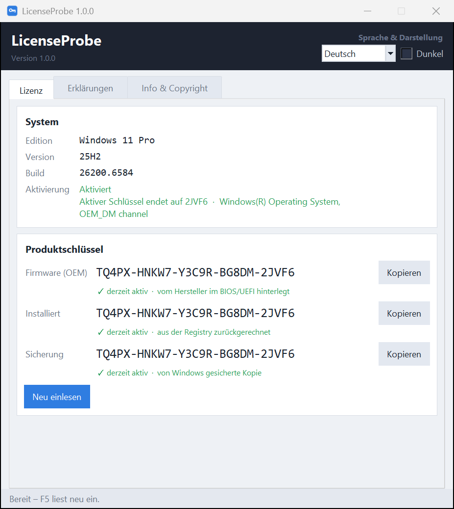
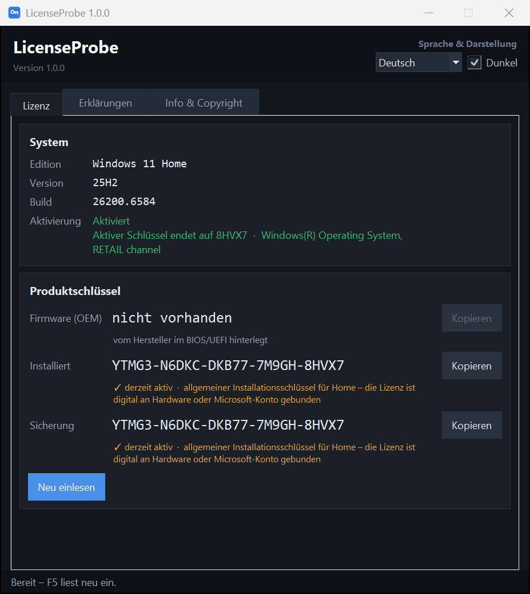

# LicenseProbe

[](https://github.com/DerAlexmann/LicenseProbe/actions/workflows/ci.yml)

Shows the Windows product keys of a computer in plain text – quickly and
without a detour through the command prompt or the registry editor. It reads
the firmware, the registry and the backup kept by Windows, and adds edition,
version and activation status. The interface comes in German and English,
light and dark.

*[Deutsche Fassung: README.md](README.md)*



*The keys in the pictures are made up or publicly known generic installation
keys from Microsoft.*

## What it does

- **Three sources at a glance:**
  - **Firmware (OEM)** – the key the manufacturer of a computer that came with
    Windows stored in the BIOS/UEFI (ACPI table MSDM);
  - **Installed** – the key of the running Windows, decoded from the registry
    value `DigitalProductId`;
  - **Backup** – the copy the Windows licensing service keeps for itself
    (`BackupProductKeyDefault`).
- **Activation status** including the licence channel (retail, OEM, volume).
  The source whose key is currently active is marked in green.
- **Recognises digital licences:** if the system only holds a generic
  installation key from Microsoft, LicenseProbe marks it in orange. The
  licence is then tied to the hardware or a Microsoft account, and the key
  shown is not a licence.
- **Copy** any key with one click, **read again** with `F5`.
- **German and English**, light and dark scheme – both switchable without the
  window changing at all.
- **Read-only and without administrator rights.** No key is ever stored or
  sent anywhere.



## Running it

**As a program:** download `LicenseProbe.exe` from the
[releases](../../releases) and start it. Nothing is installed; the settings
file appears next to it once you switch language or scheme or close the
window.

> **On first start**: the executable is not signed, so Windows SmartScreen
> asks once – "More info" → "Run anyway". Antivirus software also tends to
> hold on to a freshly downloaded, unknown file for a few seconds while it
> scans it; starting the program during that time may fail with "Access
> denied". Wait a moment and start it again. To be on the safe side, compare
> the SHA-256 checksum from the release notes first.

**As a script:** double-click `LicenseProbe.pyw`. All it needs is Python 3.10
or newer with Tkinter, which ships with the Windows installer. No further
packages are required.

```bash
python LicenseProbe.pyw
```

## Keys

| Key | Effect |
|---|---|
| `F5` | read everything again |

## How the keys are read

- **Installed:** Windows does not store the key as text but as a base-24
  number in bytes 52 to 66 of `DigitalProductId`. LicenseProbe decodes it –
  including the scheme used since Windows 8, which inserts an "N" at an
  encoded position.
- **Firmware:** `GetSystemFirmwareTable` returns the ACPI table MSDM; the OEM
  key sits there as text from byte 56 on. Without that table the computer has
  no stored key.
- **Activation:** a WMI query of `SoftwareLicensingProduct` through
  PowerShell. It takes a few seconds and runs in the background; Windows only
  reveals the last five characters of the active key.

None of this needs administrator rights, and none of it changes anything on
the system. The settings file `licenseprobe.json` only holds language,
scheme and window position.

## Adding a language

German is the source language: the German text in the code is also the key.
`LANGUAGE_NAMES` and `TRANSLATIONS` sit at the end of `LicenseProbe.pyw`. Add
a code to `LANGUAGE_NAMES`, add a section to `TRANSLATIONS`, and the selector
in the top right offers the language right away. Untranslated lines fall back
to German automatically.

## Building it yourself

```bash
pip install pyinstaller
build.cmd
```

The result is `dist\LicenseProbe.exe`. The program icon can be recreated with
`python icon_erzeugen.py`, which needs Pillow.

## Contributing

Bug reports, suggestions and translations are welcome –
[CONTRIBUTING.md](CONTRIBUTING.md) covers the layout, the style and the tests
(it is written in German, but issues and pull requests in English are just as
welcome). Please never post a full product key in an issue; the last five
characters are always enough. Please report security issues through the
route described in [SECURITY.md](SECURITY.md) rather than as an issue.

## Licence

[MIT](LICENSE) – Copyright 2026 Alexander Unverhau.
Created with assistance of Claude AI.
